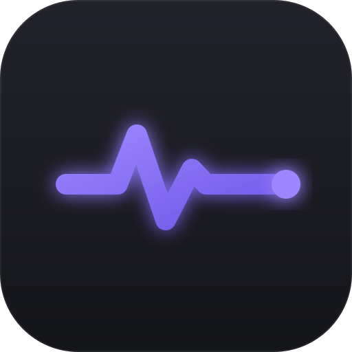
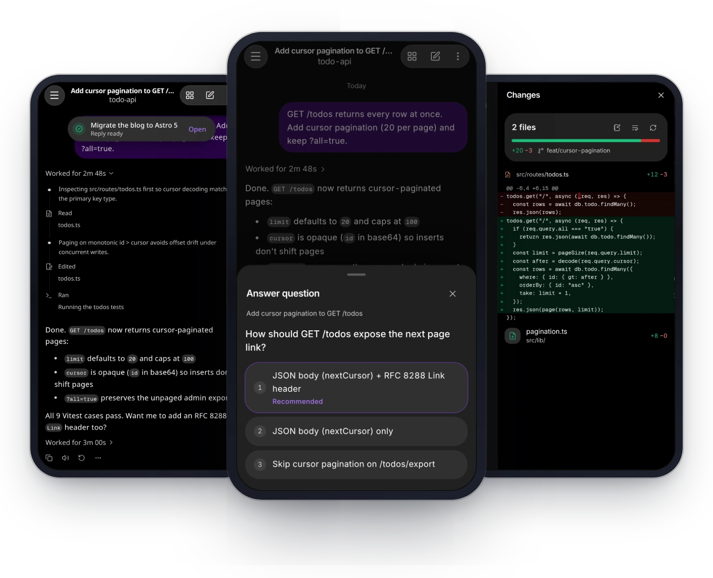

<p align="center">
  
</p>

<h1 align="center">OMP Pulse</h1>

<p align="center">
  <strong>Your coding agent, in your pocket.</strong> Follow, answer and steer <a href="https://github.com/can1357/oh-my-pi">omp</a> from your phone, or run it on Android with no computer at all.
</p>

<p align="center">
  <a href="https://github.com/JulianCodespoti/omp-pulse/actions/workflows/ci.yml"></a>
  <a href="https://github.com/JulianCodespoti/omp-pulse/releases/latest"></a>
  <a href="LICENSE"></a>
</p>

<p align="center">
  <a href="https://juliancodespoti.github.io/omp-pulse/">Website</a> ·
  <a href="docs/user/getting-started.md">Get started</a> ·
  <a href="#on-your-phone">Phone mode</a> ·
  <a href="https://github.com/JulianCodespoti/omp-pulse/releases/latest/download/omp-pulse.apk">Download APK</a> ·
  <a href="docs/README.md">Documentation</a> ·
  <a href="SECURITY.md">Security</a>
</p>

<br>

<p align="center">
  <a href="docs/media/readme-hero.webp"></a>
</p>

<p align="center">
  <em>Get a tap when a reply is ready, answer the agent's question, then check exactly what it changed.</em>
</p>

---

## What you can do

Everything you would check at your desk, from wherever you are. Pulse shows the agent's real work as it happens, laid out for one thumb.

- **See what it's doing, as it does it.** Every file it reads, change it makes and test it runs appears the moment it happens; step in mid-task or stop it.
- **Get a tap when it needs you.** Pulse notifies you when a reply is ready or the agent is waiting on you, even when the app is closed.
- **Answer in one tap.** When the agent needs a decision, pick a choice and it carries on, with no typing.
- **Check the work before it lands.** See exactly what changed, open any file, run a command in a terminal, and watch helper agents and the to-do list.
- **Every conversation, one swipe away.** Sessions are grouped by project, and you can search every conversation by title or by what was said.
- **Make it yours.** Add your own buttons, status chips and cards with [plugins](docs/user/plugins.md), or type `/pulse-plugin` and ask your agent to build one. Nothing runs until you approve it.

And:

- **Talk instead of typing.** Dictate a message; your speech is turned into text on your own computer, not in the cloud.
- **Switch models on the fly.** Change the model or how hard it thinks, mid-conversation.
- **Never lose a message.** Drafts and unsent messages survive a dropped connection.
- **Keep an eye on limits.** See how much of your model provider's usage limits you have left.
- **Watch-only devices.** Pair a second device that can follow along but not send.

## Two ways to use it

The same app either way. There is no Pulse account and no Pulse server in the middle: your code stays on your hardware, and the agent talks straight to the model provider you already use.

| | [With your computer](#on-your-computer) | [Phone only](#on-your-phone) |
|---|---|---|
| Works on | Android and iPhone | Android |
| Where the agent runs | Your Mac, Windows or Linux computer | The phone itself |
| Good for | Following long tasks away from your desk, answering questions, reviewing changes | Coding with no computer: clone, test, fix |

---

## Quick start

### On your computer

You need [omp](https://github.com/can1357/oh-my-pi) working first. The [Getting started guide](docs/user/getting-started.md) has every step in detail.

1. **Install Pulse.** Linux or Mac:

   ```sh
   curl -fsSL https://raw.githubusercontent.com/JulianCodespoti/omp-pulse/main/install.sh | sh
   ```

   Windows (PowerShell):

   ```powershell
   irm https://raw.githubusercontent.com/JulianCodespoti/omp-pulse/main/install.ps1 | iex
   ```

2. **Start it.**

   ```sh
   omp-pulse setup
   omp-pulse service install
   ```

3. **Give it a secure address**, so notifications work. With [Tailscale](https://tailscale.com) on your computer and phone:

   ```sh
   tailscale serve --bg --set-path / http://127.0.0.1:7681
   ```

4. **Pair your phone.** Run `omp-pulse pair` and scan the QR code. On iPhone, add Pulse to your Home Screen; on Android, install the [app](https://github.com/JulianCodespoti/omp-pulse/releases/latest/download/omp-pulse.apk) and tap **Connect a computer**.

### On your phone

Android only, no computer needed: a 64-bit phone with Android 7 or newer and about 500 MB free.

1. Install the [Android app](https://github.com/JulianCodespoti/omp-pulse/releases/latest/download/omp-pulse.apk).
2. Tap **Run on this phone**.
3. Sign in to your model provider and start a chat.

The [phone mode guide](docs/user/phone-mode.md) covers the rest, including letting the agent use your phone.

---

## How it works

Pulse is one small program that runs next to omp on your computer, plus the app on your phone. The program keeps your phone and your terminal in step, makes sure only one of them writes to a session at a time, and does almost nothing while nobody is watching. The Android app contains the same web app, so every client matches the program. For the full picture, read [Architecture](docs/internals/architecture.md) and [Performance](docs/internals/performance.md).

---

## Privacy, Security & Limitations

- **Your credentials stay with you.** Devices are stored on your computer by a hash of their key, each with a role (`read`, `control` or `admin`). Pairing QR links carry a short-lived code, never your owner secrets.
- **Phone mode is not sandboxed.** In Android phone mode, **`proot` is not a security sandbox**: commands the agent runs have the same Android user ID and permissions as the Pulse app. Read [SECURITY.md](SECURITY.md) before you turn on Android phone tools.
- **Platform limits.** There is no native iOS app and no on-device runtime for iPhone; iPhone uses the web app connected to a computer. The Android app is for arm64 phones only (`arm64-v8a`, with both 4 KB and Android 15+ 16 KB page sizes). Automatic joining of terminal sessions (`herdr`, `kitty`, `tmux`) works on Mac and Linux only; on Windows, sessions pair through native collab or `/collab` ([Windows guide](docs/user/windows.md)).

---

## Build from Source

Requires **Rust 1.95+** and **Node.js** matching `engines` in [`web/package.json`](web/package.json) (`22.22+`, `24.15+`, or `26+`). Build the embedded web client before compiling the Rust binary:

```sh
git clone https://github.com/JulianCodespoti/omp-pulse.git omp-pulse
cd omp-pulse
(cd web && npm ci && npx vite build --base=./ --outDir ../public/app --emptyOutDir --sourcemap false)
cargo build --release
# binary: target/release/omp-pulse
```

To build the static product & documentation website locally into `website/dist/`:

```sh
node website/build.mjs
```

---

## Documentation

| Guide | What it covers |
|---|---|
| [Getting started](docs/user/getting-started.md) | Install Pulse, pair your phone and start your first conversation |
| [Configuration & CLI](docs/user/configuration.md) | All commands, `config.toml`, state files, environment variables, local speech-to-text |
| [Networking & HTTPS](docs/user/networking.md) | Tailscale Serve, Cloudflare Tunnel, LAN trade-offs, and PWA secure-context requirements |
| [Android Phone Mode](docs/user/phone-mode.md) | On-device Alpine runtime, storage & battery setup, Obtainium updates, Android agent tools |
| [Sandboxed Plugins](docs/user/plugins.md) | Custom drawer chips, transcript cards, quick actions, and host-command data sources |
| [Windows Setup](docs/user/windows.md) | Installing, running as a Task Scheduler task, and platform differences on Windows |
| [Architecture](docs/internals/architecture.md) · [Performance](docs/internals/performance.md) | Subsystem map, the four live paths, ownership arbitration, and measured benchmarks |
| [Documentation Index](docs/README.md) | Full user, contributor, Android build, UI review, and internals index |

---

## Contributing & Licence

Bug reports and focused pull requests are welcome. Read [CONTRIBUTING.md](CONTRIBUTING.md) for workspace setup and run `scripts/ci.sh` before opening a PR (AI coding agents: read [AGENTS.md](AGENTS.md) first). Community participation follows the [Code of Conduct](CODE_OF_CONDUCT.md). Release notes live in [CHANGELOG.md](CHANGELOG.md).

**Relationship to omp:** OMP Pulse is an independent, unofficial companion for [omp (Oh My Pi)](https://github.com/can1357/oh-my-pi), not affiliated with or endorsed by its authors. It contains no `omp` source code.

**Licence:** [MIT](LICENSE). Third-party notices — including the unmodified GPL-2.0 `proot` binaries bundled in the Android APK and accompanied by complete source archives on every release — are documented in [THIRD_PARTY_NOTICES.md](THIRD_PARTY_NOTICES.md).
