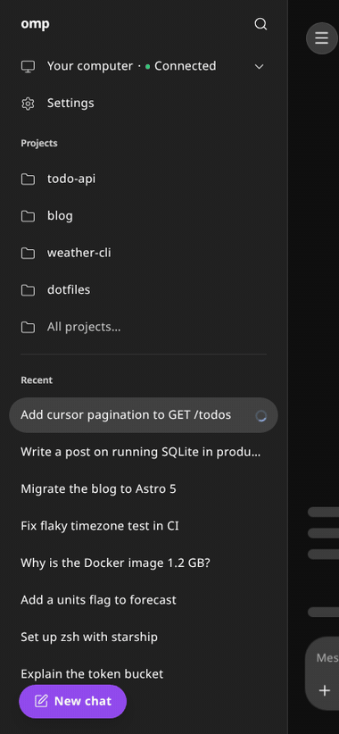
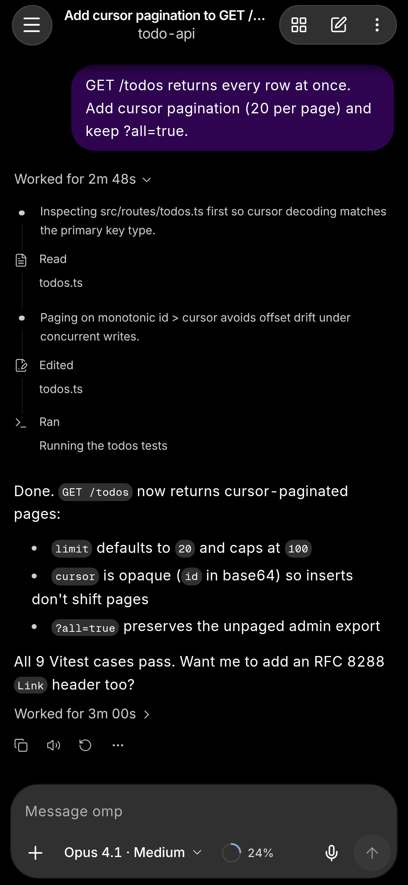
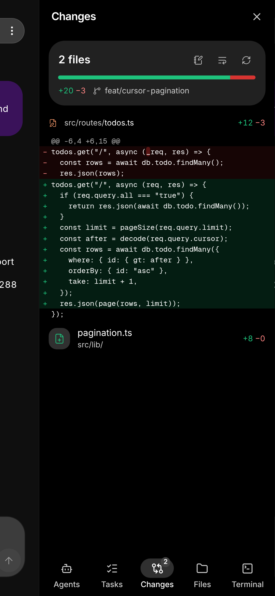
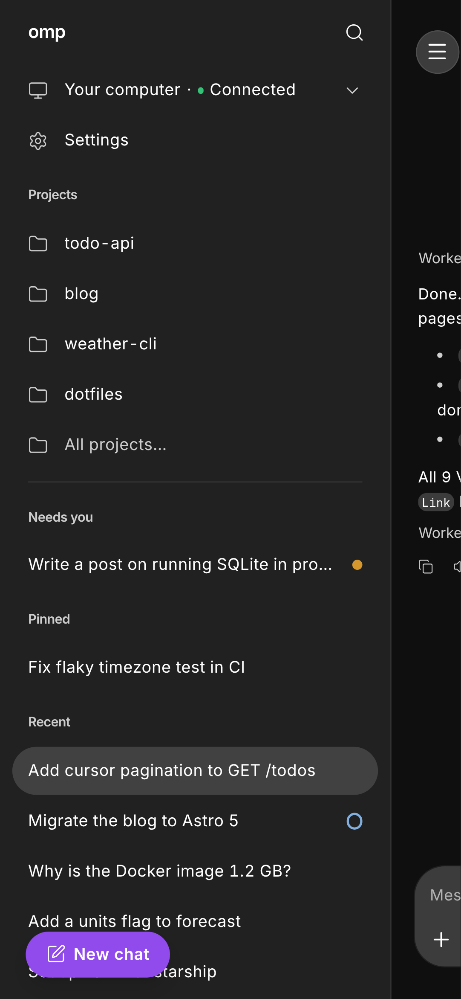
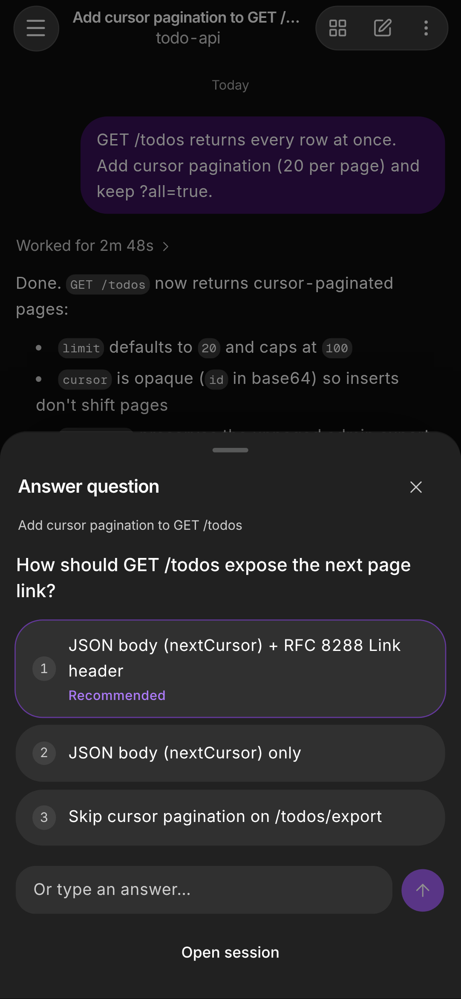
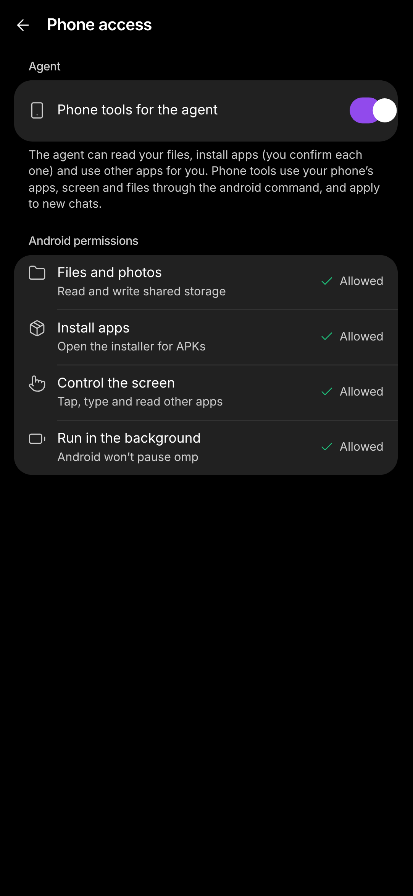
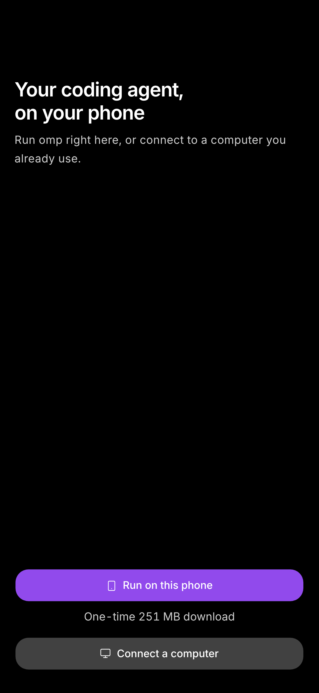

<p align="center">
  
</p>

<h1 align="center">OMP Pulse</h1>

<p align="center">
  <strong>Keep working with <a href="https://github.com/can1357/oh-my-pi">omp</a> from your phone — connected to your computer, or running entirely on Android.</strong>
</p>

<p align="center">
  <a href="https://github.com/JulianCodespoti/omp-pulse/actions/workflows/ci.yml"></a>
  <a href="https://github.com/JulianCodespoti/omp-pulse/releases/latest"></a>
  <a href="LICENSE"></a>
</p>

<p align="center">
  <a href="https://juliancodespoti.github.io/omp-pulse/">Website</a> ·
  <a href="#quick-start">Quick start</a> ·
  <a href="#phone-mode-android-no-computer">Android Phone Mode</a> ·
  <a href="https://github.com/JulianCodespoti/omp-pulse/releases/latest/download/omp-pulse.apk">Download APK</a> ·
  <a href="docs/README.md">Documentation</a> ·
  <a href="SECURITY.md">Security</a>
</p>

<br>

<p align="center">
  <a href="docs/media/demo.gif"></a>
  &nbsp;&nbsp;
  <a href="docs/media/screenshot-chat.png"></a>
  &nbsp;&nbsp;
  <a href="docs/media/screenshot-workspace.png"></a>
</p>

<p align="center">
  <em>Left: opening a live session from the drawer and watching edits and tests stream in real time. Middle: expanded work rail, markdown reply, model &amp; context ring. Right: uncommitted git diff inside the right-hand workspace drawer.</em>
</p>

---

## Why OMP Pulse

**OMP Pulse** is a single-binary Rust daemon, an installable React PWA, and a native Android app built specifically for **[omp (Oh My Pi)](https://github.com/can1357/oh-my-pi)**. There is no hosted relay service in the middle: your sessions, credentials, and code stay on your hardware, and model calls go straight from `omp` to the provider you already use.

It supports two distinct ways of working under one interface:

| Mode | Where `omp` & your code live | Best for |
|---|---|---|
| **[Desktop daemon mode](#desktop-daemon-mode)** | Your Linux, macOS, or Windows machine (`omp-pulse` daemon + Tailscale HTTPS) | Monitoring long tasks away from your desk, reviewing diffs, answering `ask` prompts, or steering live terminal turns from iPhone or Android |
| **[Android phone mode](#phone-mode-android-no-computer)** | Directly on an arm64 Android phone (pinned Alpine Linux + `omp` under `proot`) | Coding, cloning repos, running builds/tests, and automating Android tasks with no computer involved |

---

## Product Tour

<table>
  <tr>
    <td align="center" width="33%">
      <a href="docs/media/screenshot-drawer.png"></a>
      <br>
      <strong>Unified Session Drawer</strong>
      <br>
      <sub>Computer connection status, project folders, <em>Needs you</em> questions, pinned chats, recent history, and full-transcript search in one left drawer.</sub>
    </td>
    <td align="center" width="33%">
      <a href="docs/media/screenshot-ask.png"></a>
      <br>
      <strong>Unblock Agents Anywhere</strong>
      <br>
      <sub>Encrypted Web Push and native Android notifications wake your phone when a turn finishes or blocks on a question. Answer in one tap.</sub>
    </td>
    <td align="center" width="33%">
      <a href="docs/media/screenshot-phone-tools.png"></a>
      <br>
      <strong>On-Device Linux &amp; Phone Tools</strong>
      <br>
      <sub>Run <code>omp</code> locally on Android. Opt-in <em>Phone tools for the agent</em> let it inspect the screen, launch apps, and work with shared storage.</sub>
    </td>
  </tr>
</table>

### Highlights

- **Token-level live streaming:** Watch reasoning, file reads, inline diffs, and shell output arrive live over compressed WebSockets. Steer a running turn, queue a follow-up, or stop it cleanly.
- **Single-writer safety:** `omp` rewrites session JSONL files from memory, so two writers would destroy history. OMP Pulse verifies process, bridge, and terminal ownership before writing — and guides you to `/collab` whenever a terminal owns the file.
- **Full five-tab workspace:** Swipe from the right (or tap the grid button) for **Agents** (subagent transcripts & steering), **Tasks** (plan & turn timeline), **Changes** (working-tree git diffs), **Files** (browse, highlight, edit with conflict checks), and **Terminal** (run commands with live output).
- **Resilient on mobile networks:** Drafts, attachments, and queued sends persist locally across drops. Delivery receipts distinguish saved, received, and started prompts without replaying uncertain sends behind your back.
- **Voice dictation & desktop controls:** Switch models and thinking levels through the real desktop extension API, inspect token & provider rate-limit meters, and optionally run local `sherpa-onnx` speech-to-text on your machine.

---

## Quick start

### Desktop daemon mode

Install and configure [omp](https://github.com/can1357/oh-my-pi) on your computer first (`omp --version`).

#### 1. Install `omp-pulse`

**Linux** (`x86_64` or `aarch64`, static `musl` — any distro) and **macOS** (Apple Silicon or Intel):

```sh
curl -fsSL https://raw.githubusercontent.com/JulianCodespoti/omp-pulse/main/install.sh | sh
```

**Windows** (`x86_64`, PowerShell 5.1+):

```powershell
irm https://raw.githubusercontent.com/JulianCodespoti/omp-pulse/main/install.ps1 | iex
```

*(Or download [`install.ps1`](https://raw.githubusercontent.com/JulianCodespoti/omp-pulse/main/install.ps1) to inspect it first and run `powershell -ExecutionPolicy Bypass -File install.ps1`.)*

Both installers verify the archive against the release's `SHA256SUMS` before installing to `~/.local/bin` (Unix) or `%LOCALAPPDATA%\Programs\omp-pulse` (Windows).

#### 2. Configure & start the background service

```sh
omp-pulse setup
omp-pulse service install
```

`setup` writes `config.toml`, generates the desktop owner credential, and installs the `omp` desktop-control extension (reopen idle `omp` sessions to load it). Prefer running in a terminal instead of a login service? Run `omp-pulse serve`.

#### 3. Expose over private HTTPS (recommended)

The daemon binds to `127.0.0.1:7681` by default. With [Tailscale](https://tailscale.com) signed into the same tailnet on your computer and phone:

```sh
tailscale serve --bg --set-path / http://127.0.0.1:7681
```

Tailscale provides a trusted HTTPS certificate (`https://<machine>.<tailnet>.ts.net/`) so the PWA can install, cache history offline, and subscribe to Web Push. For Cloudflare Tunnel or LAN setups, see [Networking](docs/user/networking.md).

#### 4. Pair your phone

```sh
omp-pulse pair
```

- **iPhone or Android browser (PWA):** Open the printed URL or scan the QR code, complete enrollment, and add the app to your Home Screen.
- **Android native app:** Install [`omp-pulse.apk`](https://github.com/JulianCodespoti/omp-pulse/releases/latest/download/omp-pulse.apk), tap **Connect a computer**, enter your `https://…/app/` URL, and scan or type the 6-digit pairing code.

Pairing codes are single-use and expire after 5 minutes. Use `omp-pulse pair --role read` for a watch-only device, or run `omp-pulse doctor` anytime to verify every link in the live-sync chain.

---

### Phone mode (Android, no computer)

Run `omp` and an Alpine Linux workspace directly on an **arm64** phone running **Android 7.0+**. Reserve roughly **500 MB** of free storage for the unpacked runtime (~250 MB one-time download) plus space for your repositories.

<p align="center">
  <a href="docs/media/screenshot-phone-mode.png"></a>
</p>

1. Download and install **[`omp-pulse.apk`](https://github.com/JulianCodespoti/omp-pulse/releases/latest/download/omp-pulse.apk)** from the latest GitHub Release (updates are signed with a stable key and work cleanly with [Obtainium](https://github.com/ImranR98/Obtainium)).
2. Open the app and tap **Run on this phone**. Every Alpine package and the `omp` binary are verified against pinned SHA-256 digests before unpacking.
3. Open **Settings › Model providers** to sign in (Anthropic, OpenAI Codex, GitHub Copilot, Gemini, OpenRouter, DeepSeek, or API key), pick a folder, and start a chat.

Want the agent to interact with Android itself? Enable **Settings › Phone access › Phone tools for the agent** to expose the `android` CLI and `phone` tool server (app launching, clipboard, screenshots, and accessibility-gated UI actions). Read the [Phone Mode Guide](docs/user/phone-mode.md) for full details.

---

## Architecture at a Glance

```text
phone ──HTTPS/WSS──▶ server/http.rs ──▶ server/ws.rs (bounded hub) ──▶ phone
                          │                  ▲   ▲   ▲   ▲
                          │                  │   │   │   └── omp/collab.rs   (desktop /collab relay)
                          │                  │   │   └────── omp/bridge.rs   (desktop extension stream)
                          │                  │   └────────── omp/child.rs    (daemon rpc-ui pool)
                          └─────────────────▶│               sessions/watcher.rs (JSONL file tail)
```

In desktop mode, the daemon spawns `omp` processes for phone-created conversations, connects via the desktop extension or `omp`'s `/collab` relay for live terminal sessions (including native adoption in [Tern](docs/user/configuration.md#tern)), and tails JSONL session files for history. Every session has a single verified writer.

- **Zero OpenSSL:** Compiled into a single static binary on Linux (`musl`) and native executables on macOS and Windows. RFC 8291 Web Push encryption and RFC 8292 VAPID signing are implemented in pure Rust (`p256`, `hkdf`, `aes-gcm`, `rustls`).
- **Bounded hot paths:** The filesystem watcher skips parsing when no client is listening. Each WebSocket subscriber has strict frame and byte budgets, falling back to sequence-keyed resync snapshots rather than unbounded memory growth.
- **Same client everywhere:** `public/app/` is embedded into the Rust binary at compile time and packaged into the Capacitor Android APK, keeping release and protocol versions in lockstep.

---

## Privacy, Security & Limitations

- **Local-first credentials:** Device tokens are stored on the daemon as SHA-256 digests with `read`, `control`, or `admin` roles. Pairing QR links carry short-lived enrollment codes in the URL fragment, never owner secrets.
- **On-device runtime boundary:** In Android phone mode, **`proot` is not a security sandbox** — commands executed by the agent run with the app's own Android user ID and granted permissions. Review [SECURITY.md](SECURITY.md) before enabling Android phone tools.
- **Platform notes:** There is no native iOS app or iOS on-device runtime (iPhone uses the full PWA connected to a computer). The Android APK targets `arm64-v8a` (both 4 KB and Android 15+ 16 KB page sizes). Terminal auto-adoption (`herdr`, `kitty`, `tmux`) is Unix-only; Windows sessions pair via native collab or `/collab` ([Windows guide](docs/user/windows.md)).

---

## Build from Source

Requires **Rust 1.95+** and **Node.js** matching `engines` in [`web/package.json`](web/package.json) (`22.22+`, `24.15+`, or `26+`). Build the embedded web client before compiling the Rust binary:

```sh
git clone https://github.com/JulianCodespoti/omp-pulse.git omp-pulse
cd omp-pulse
(cd web && npm ci && npx vite build --base=./ --outDir ../public/app --emptyOutDir --sourcemap false)
cargo build --release
# binary: target/release/omp-pulse
```

To build the static product & documentation website locally into `website/dist/`:

```sh
node website/build.mjs
```

---

## Documentation

| Guide | What it covers |
|---|---|
| [Configuration & CLI](docs/user/configuration.md) | All commands, `config.toml`, state files, environment variables, local speech-to-text |
| [Networking & HTTPS](docs/user/networking.md) | Tailscale Serve, Cloudflare Tunnel, LAN trade-offs, and PWA secure-context requirements |
| [Android Phone Mode](docs/user/phone-mode.md) | On-device Alpine runtime, storage & battery setup, Obtainium updates, Android agent tools |
| [Sandboxed Plugins](docs/user/plugins.md) | Custom drawer chips, transcript cards, quick actions, and host-command data sources |
| [Windows Setup](docs/user/windows.md) | Installing, running as a Task Scheduler task, and platform differences on Windows |
| [Architecture](docs/internals/architecture.md) · [Performance](docs/internals/performance.md) | Subsystem map, the four live paths, ownership arbitration, and measured benchmarks |
| [Documentation Index](docs/README.md) | Full user, contributor, Android build, UI review, and internals index |

---

## Contributing & Licence

Bug reports and focused pull requests are welcome. Read [CONTRIBUTING.md](CONTRIBUTING.md) for workspace setup and run `scripts/ci.sh` before opening a PR (AI coding agents: read [AGENTS.md](AGENTS.md) first). Community participation follows the [Code of Conduct](CODE_OF_CONDUCT.md). Release notes live in [CHANGELOG.md](CHANGELOG.md).

**Relationship to omp:** OMP Pulse is an independent, unofficial companion for [omp (Oh My Pi)](https://github.com/can1357/oh-my-pi), not affiliated with or endorsed by its authors. It contains no `omp` source code.

**Licence:** [MIT](LICENSE). Third-party notices — including the unmodified GPL-2.0 `proot` binaries bundled in the Android APK and accompanied by complete source archives on every release — are documented in [THIRD_PARTY_NOTICES.md](THIRD_PARTY_NOTICES.md).
